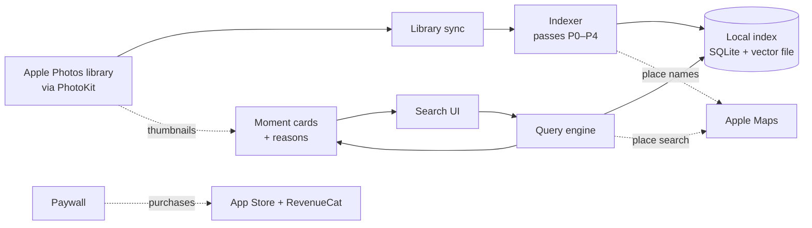

# Architecture

> Status: stack and scope decided (see [decisions.md](decisions.md)). The design rules below are still confirmed or adjusted by the Phase 0 tests.

## Overview

All analysis runs on the iPhone, and there is no Lahza server. The only network calls are place-name lookups to Apple Maps, purchases through the App Store and RevenueCat, and the one-time model download from Apple.

## Components

### Library sync
- Reads photo and video metadata through PhotoKit.
- Includes the iCloud Shared Library and excludes the Hidden album.
- Reads albums named after people (e.g. "Ahmed") to learn names.
- Tracks changes: a change observer while the app runs, and a saved change token checked at launch.
- Supports limited-library access.
- Photo access is asked on onboarding's last step. Without it Lahza still runs and points to iPhone Settings (decision 30).
- Deletes index data for photos the user stops sharing, or when access is revoked.

### Indexer
Builds the local index in passes, cheapest first, so search works within minutes:

| Pass | What it does | When it runs |
|---|---|---|
| P0 Metadata | Reads date, GPS, type, favorites, and the user's own captions/keywords (iOS 27) | Foreground, about 1 min per 30k photos |
| P0b Structure | Adds offline city/country names; groups photos into moments and trips | Foreground, seconds |
| P1a Photo tags | From one local image per photo (about 360 px, network off): Apple Vision's photo tags, face and person counts, Vision's utility verdict and an aesthetics score | Foreground while Lahza is open (decision 38); later a user-started background task (CPU only unless the entitlement is granted; see below) |
| P1b Embedding | The same image through the image model | Later, once the model ships (decision 39) |
| P2 Place names | Looks up park/restaurant names for photo clusters in Apple Maps (rate-limited and cached) | Foreground only |
| P3 Text | Reads text in screenshots, documents and receipts | Background (CPU), while charging |
| P4 Video | Analyzes sampled frames from videos stored on the device (up to 30 per video, videos ≤10 min) | Background (CPU), while charging |

P1 order: the last 12 months newest first, then everything older, newest first. With the embedding, a small random sample goes first, to calibrate scores.

### Local index
- **SQLite (GRDB)** holds metadata, labels, moments, places, saved places, name albums, and a full-text (FTS5) index of text found in photos.
- **A flat file of embedding vectors** (`Index/vectors.lzvf`, `VectorStore`) holds about 1.5 KB per photo at 16-bit. Its header names the model and carries the index's identity, so a new model or a rebuilt index (new asset ids) starts it again.
- Search compares the query against every vector directly. On a Mac, 100k photos take about 7–8 ms (16-bit to 32-bit in blocks, then one matrix-vector product); we haven't measured an iPhone yet.
- The index is protected with iOS data protection and excluded from backups.
- It is a cache of the library (decision 33): one SQLite file under Application Support. A damaged file, or one from a newer build, is rebuilt from the library at launch, keeping saved places. Revoking photo access deletes it.
- Sync (`LZIndex`): one writer applies PhotoKit's persistent-history changes since the saved token, and reads the whole library instead when the history can't answer (first run, an expired token, a very large change, limited access). A full read goes newest first and saves its progress with every batch, so recent photos are searchable early and a killed app resumes where it stopped.
- Structure (P0b): the same writer gives each photo a time zone and local day (borrowed from a nearby located photo when it has no GPS), a city and country from the offline place list, and groups days into moments, home bases and trips. Moment ids stay stable when a day is grouped the same way again.
- Saved places: user rows in the index, saved from a moment (Save place) or managed in Settings › Saved places. Each write is one transaction that mirrors the place into the place index with its names and marks the days around it for the structure pass, so its moments read the saved name ("My pitch"); search knows the name at once ("at my pitch", "pitch"). "at my …" naming no saved place says so ("You have no saved place called “my pitch”.") and is never looked up on Apple Maps; "my …" about people or trips ("from my uncle", "from my travels") is not a place. "home" after No home says it was chosen. Deleting a place, from its sheet or a swipe, always asks first. Home is estimated from where photos are taken at night unless the person picks a saved place, one of their night places, or No home (then no trips). Rebuild keeps all of this; Delete index removes it.
- Photo tags (P1a): a separate queue (`VisualQueue`) runs Vision's `ClassifyImageRequest` with face, person and aesthetics requests over one local image per photo, and keeps each tag that passes Apple's high-recall filter with its confidence and two flags: *likely* (0.7 precision) and *precise* (0.9). Confidences are compared only within one tag. It writes only its own tables (`visual_label`, `asset_label`, `asset_visual`), works in batches with checkpoints that publish a new index version, pauses while the iPhone is hot, and runs only while Lahza is open. A photo without a large enough local image is marked as waiting for iCloud and checked again later. A content edit, a new pass version or a changed Vision tag list (an iOS update) tags a photo again. Settings › Search index shows how far it has got.
- Place names (P2): a separate queue asks Apple Maps for the named area (park, beach, landmark) around each ~150 m cell of photos worth naming, sending only the cell's centre (never a photo's position), within a shared budget. It runs only while Lahza is open, and stops when **Apple Maps place names** is turned off in Settings › Search index (on by default, disclosed there and in Privacy); answers are cached on the device so a rebuild doesn't ask again.

### Query engine
Pipeline:
1. Parse the question.
   - On Apple Intelligence iPhones, Apple's Foundation Models turns it into structured parts (activity, place, time, people, text, media type).
   - Rules are the fallback, and the fast path for simple searches.
2. Resolve place and time, including saved places and name albums.
3. Score each part.
4. Combine the scores softly.
5. Share evidence within moments (if Phase 0 confirms it helps).
6. Sort into tiers: Best / More / Location unknown.
7. Group into moment cards (with a grid toggle).
8. Attach reason chips.

In search v0 (`LZSearch`), English rules do all the parsing. They fill the same slot model a Foundation Models parser will later, each slot tied to the words it came from. Words about what's in photos go through a word map (`VisualVocabulary`): curated concepts with their forms and synonyms ("hike", "hikes", "trek" → hiking; "football" → soccer and football), and every other Vision tag by its own name ("sand dunes"). Each tagged word is its own slot and chip ("soccer · photo tag"); words with no tag ("party") stay "not yet" chips. Nothing is dropped, and no content word is ever looked up on Apple Maps. Places resolve from the own index first (names, then a typo pass), then the offline place list, and only then from one Apple Maps search per query, cached on the iPhone for 30 days. Search then scores an in-memory column snapshot of the index (about 8 MB per 100k photos, rebuilt per index version) in one pass: place, date, trip and photo-tag scores are fused, with the photo type as a filter. A tag scores by how sure Vision was (precise, likely, or only the high-recall filter); a related tag reaches More but never Best, and its chip's editor can remove the related tags (decision 36). A photo not checked yet scores as unknown, and the coverage line says "Checked N of M photos so far" (decision 37). Screenshots and Vision's utility photos rank lower, except for documents ("receipt", "passport"), where they are what's wanted. Results are tiered (Best only inside the place and the dates; near misses under More), grouped into moment cards and trips, and every hit says why it matched. When nothing matches, the answer names the part of the query that found nothing and offers taps that widen it, with counts; with no tap left, the library's example searches follow. Each "understood as" chip opens an editor (the place's candidates, radius and "near", an Apple Maps lookup on request; date presets, part of day and custom dates; photo type): an edit changes the slots, the field's words are rendered from them, and the search runs again. Results show as moment cards or as a grid of every photo (by section, then month); switching keeps the result and the place. A photo opens the viewer, which pages through the list with when (in the photo's own time zone) and where each was taken, and "Why this matched" in sentences ("No GPS in this photo. Location comes from a photo taken 5 min earlier in the same outing."). The viewer reads only what the iPhone holds: an original kept only in iCloud shows its local version, and a video only in iCloud its poster. On a Mac, a search over 100k photos takes about 110–170 ms, under the 300 ms target.

A query can ask for one occasion or an order. "The first time" (or "the last time") shows only the earliest (or latest) occasion of the Best matches: the whole trip when the place is a city, region or country away from home or the query asks for trips, otherwise that outing. Undated photos never count, and a received photo or screenshot doesn't beat a real outing. A row after it ("9 later times · Show all") lists every time: oldest first after the first time, newest first after the last. "Oldest first" ("in order", "over the years") turns moments, trips and the grid oldest to newest. Both are chips with their own editor. "Recently" next to named dates ("recently, in 2026") gives way to them.

A free search covers the last 12 months, from the start of that day (decision 34): the engine scores the whole library, keeps what was taken since then, and counts the older matches for one "N more from earlier years" row with the unlock; its caption reads "Searched your last 12 months". When every match is older, the answer says "No matches in the last 12 months." rather than nothing; when the first time is older, it says so ("Your first time at … was before the last 12 months.") with the unlock row, and never shows the earliest visit in the window as the first. What it says about the library counts every year; example searches and widening taps count what a tap shows. A widening tap whose matches are all older stays, counted by them ("Dubai, any time · 57"), and lands on that answer with a row of the same count; taps that show photos come first. A first build that has stopped short of the window says "so far" instead. The app reads the window from the entitlement at every search (`SearchScope.since`, or the whole library once unlocked) and runs the shown search again as soon as the unlock changes, so a purchase shows the earlier years at once.

### Embedding model
- SigLIP 2 B/16, vocabulary trimmed to English, 8-bit (about 200 MB), downloaded through Apple-hosted Background Assets.
- `make model` converts it to Core ML (Tools/model). The image tower is 94 MB. The text tower is 283 MB, still with the full vocabulary; trimming it is later. Both are checked against PyTorch (cosine ≥ 0.99). Models are never committed.
- On a Mac: about 90 photos/s, and 3 ms to encode a query. On the CPU alone (the Simulator), 16-bit drifts further from PyTorch (image cosine about 0.97). iPhone numbers come from a device run.
- Search on dates and places works while the model downloads.
- Sits behind a swappable interface (`LZEmbedding`: `ImageEmbedder`, `TextEmbedder`, which take token ids until the Swift tokenizer lands). The index records which model produced the vectors, so switching models only triggers a re-index.
- It ships only if Phase 0 shows a measurable gain. Otherwise P1 runs without it.

## Design rules (proposed, evidence-backed)

- **Combine signals with soft scoring, not hard filters.** In the PhotoBench benchmark (2026), requiring every filter to match dropped correct photos on multi-part questions. Phase 0 compares soft scoring against strict filtering.
- **No AI-written description of every photo in the MVP.** In PhotoBench it barely helped: 75.0% vs 72.3% of right photos found in the top 10 (category averages). It is also very slow on a phone.
- **Brute-force vector search, no vector database.** It takes milliseconds at this library size.
- **Never download originals from iCloud.** Use the previews already on the phone. Phase 0 measures how many photos lack one; if too many do, add an opt-in small-preview download on Wi-Fi.

## Platform constraints that shape the design

- **Background limits.** In iOS 27, using the Neural Engine while the app is in the background requires Apple's background-inference entitlement. That applies even inside a user-started task, and charging doesn't lift it. iPhones get no background GPU.
  - The first index is fastest with the app open.
  - A user-started task with a Live Activity keeps indexing in the background, but runs on the CPU (slower) unless the entitlement is granted.
  - We apply for the entitlement on day 1. Apple's approval process is undocumented.
- **iCloud.** Thumbnails are requested with network access off.
  - Photos without a local preview are marked pending; place and time search still covers them.
- **Apple Maps throttling.** About 50 requests per minute, plus undocumented longer-window limits.
  - The offline place list comes first.
  - Map lookups are clustered and cached, with at most one lookup per search.
- **Device range.** An iOS 26 minimum ships to iPhone 11 and iPhone SE (3 GB RAM).
  - Features are tiered at runtime by device.
  - On 4 GB devices the image and text models are never loaded at the same time.
- **Foundation Models** works only on Apple Intelligence iPhones (15 Pro and newer), in supported languages. Its context window is small (about 4K tokens documented) and it can be rate-limited. So the rules parser is always present, and parse speed is measured in Phase 0.
- **No People data and no face-identity API** for third-party apps. That's why names come from user-made albums.

## Privacy

- Photos, embeddings and any face data never leave the device. There is no account, no backend and no analytics on content.
- Place-name lookups send photo-cluster coordinates, and typed place names with the home's rough area (rounded to whole degrees), to Apple Maps, not to Lahza. Answers to typed places are kept on the device for 30 days.
- At launch Lahza asks RevenueCat (which manages App Store purchases) whether the full library is unlocked; RevenueCat receives an anonymous ID and the purchase status, never photos.
- The only data users can choose to send is opt-in result feedback.
- Index files are protected at rest, excluded from backups, and deletable from Settings.
- Third-party licenses (the model's Apache NOTICE, the GeoNames place list's CC-BY) are credited on an Acknowledgements screen.

## Stack

- SwiftUI, Swift 6, iOS 26+, iPhone only
- The app started from a private iOS template (used with permission): its design system, navigation shell, settings and RevenueCat paywall were kept; its accounts, ads, backend sync and content were removed
- RevenueCat for purchases: one non-consumable full-library unlock (anonymous app user, entitlement checked on the device)
- SQLite (GRDB) + FTS5 + a flat vector file, searched with Accelerate (when indexing lands)
- SigLIP 2 B/16, English-trimmed, 8-bit, delivered with Background Assets (when indexing lands)
- Rule-based parser (search v0); a Foundation Models parser later

## Project layout and build

| Path | What |
|---|---|
| `ios/project.yml` | XcodeGen spec; the Xcode project is generated (`make project`) and not committed |
| `ios/App/` | The app: `Shell/` (composition root, dependencies, preferences), `Navigation/`, `Chrome/`, `Features/` (Ask, Moments, Library, Onboarding, Settings, Paywall), `Debug/` (launch arguments, developer screens) |
| `ios/Packages/LahzaKit/` | Swift package: `LZCore` (brand, environment, storage, clock, log), `LZBilling` (the one-time unlock: RevenueCat client, a StoreKit-only client for local testing, entitlement, paywall model), `LZDesign` (tokens, type, components, motion), `LZLibrary` (photo access: PhotoKit client, fake, access store, the shared fetch rules; the library reader and image provider the index uses and the viewer's video loader, live and fake; the library census for spike S2, whose screen is DEBUG-only; the DEBUG seed library), `LZGeo` (coordinates, local time and the moment rule, the offline GeoNames gazetteer, place-name folding, the Apple Maps client), `LZIndex` (the on-device search index: GRDB storage, library sync, the structure pass, the Apple Maps place-name queue, read queries and the stores the Ask, Moments and Settings screens observe, and the vector file; GRDB stays inside it), `LZEmbedding` (the embedding model behind `ImageEmbedder` and `TextEmbedder`: the converted SigLIP 2 towers loaded with Core ML), `LZSearch` (the query model, the rules parser, the time and place resolvers, scoring, tiers, grouping and reasons, and the store the Ask screen observes). Modules use the `LZ` prefix |
| `ios/Tools/gazetteer/` | Source, licence and curated aliases of the bundled GeoNames place list; `make gazetteer` rebuilds it with the `lz-gazetteer` package tool |
| `ios/Tools/model/` | The SigLIP 2 to Core ML conversion (`make model`, with pinned Python tools in a throwaway virtualenv; `make model-clean` deletes the downloads). The models land in the git-ignored `ios/.build/models` |
| `ios/Config/` | xcconfig files (secrets go only in the git-ignored `Local.xcconfig`) and `Lahza.storekit`, the local store products for Simulator purchases |
| `ios/Tests/` | App-hosted tests |

Everything runs from the command line (`cd ios`): `make run` builds and launches in the Simulator, `make test` runs the package tests on the Mac and the app tests on the Simulator. The Xcode IDE is never needed, only the installed toolchain.

For demos and search tests, `make seed-photos` fills the Simulator's Photos with the synthetic *hero* library: 557 photos and videos drawn on the Mac by the `lz-seed` package tool, with real-looking dates, GPS and Ramadan/Eid days. Kit tests read the same scenario through a fake library reader. `make grant-photos` gives Lahza access, `make probe-photos` checks what the import kept, and `make sim-reset CONFIRM=1` erases the Simulator. In DEBUG builds, Settings › Developer › Index inspector shows the index's state and a query lab that runs one search step by step (slots, dates, place candidates, counts, timings and the top hits' scores), and Label lab shows the photo-tag pass on the iPhone (speed, memory, photos waiting for iCloud, each photo's tags and flags, the iPhone's tag list against Lahza's, 256 against 360 px). The seed library's pictures are drawn, so the kit tests and the seeded Simulator tag it with stand-in tags (`SeedLabels`) instead of Vision.
