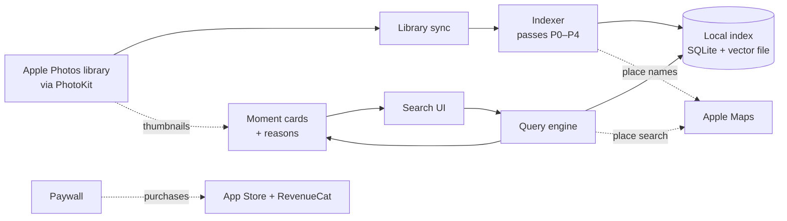

# Architecture

> Status: stack and scope decided (see [decisions.md](decisions.md)). The design rules below are still confirmed or adjusted by the Phase 0 tests.

## Overview

All analysis runs on the iPhone, and there is no Lahza server. The only network calls are place-name lookups to Apple Maps, purchases through the App Store and RevenueCat, and the one-time model download from Apple.

## Components

### Library sync
- Reads photo and video metadata through PhotoKit.
- Includes the iCloud Shared Library and excludes the Hidden album.
- Reads albums named after people (e.g. "Ahmed") to learn names.
- Tracks changes: a change observer while the app runs, and a saved change token checked at launch.
- Supports limited-library access.
- Photo access is asked on onboarding's last step. Without it Lahza still runs and points to iPhone Settings (decision 30).
- Deletes index data for photos the user stops sharing, or when access is revoked.

### Indexer
Builds the local index in passes, cheapest first, so search works within minutes:

| Pass | What it does | When it runs |
|---|---|---|
| P0 Metadata | Reads date, GPS, type, favorites, and the user's own captions/keywords (iOS 27) | Foreground, about 1 min per 30k photos |
| P0b Structure | Adds offline city/country names; groups photos into moments and trips | Foreground, seconds |
| P1 Visual | From one small local thumbnail: Apple Vision labels, face/person counts, a quality score, and the embedding | Foreground; then a user-started background task (CPU only unless the entitlement is granted; see below) |
| P2 Place names | Looks up park/restaurant names for photo clusters in Apple Maps (rate-limited and cached) | Foreground only |
| P3 Text | Reads text in screenshots, documents and receipts | Background (CPU), while charging |
| P4 Video | Analyzes sampled frames from videos stored on the device (up to 30 per video, videos ≤10 min) | Background (CPU), while charging |

P1 order:
1. A small random sample, used to calibrate scores.
2. Favorites and the last 90 days.
3. A few representative photos from every moment.
4. Everything else.

### Local index
- **SQLite (GRDB)** holds metadata, labels, moments, places, saved places, name albums, and a full-text (FTS5) index of text found in photos.
- **A flat file of embedding vectors** holds about 1.5 KB per photo at 16-bit.
- Search compares the query against every vector directly. On a Mac, 100k photos take about 4.5 ms; we haven't measured an iPhone yet.
- The index is protected with iOS data protection and excluded from backups.
- It is a cache of the library (decision 33): one SQLite file under Application Support. A damaged file, or one from a newer build, is rebuilt from the library at launch, keeping saved places. Revoking photo access deletes it.
- Sync (`LZIndex`): one writer applies PhotoKit's persistent-history changes since the saved token, and reads the whole library instead when the history can't answer (first run, an expired token, a very large change, limited access). A full read goes newest first and saves its progress with every batch, so recent photos are searchable early and a killed app resumes where it stopped.
- Structure (P0b): the same writer gives each photo a time zone and local day (borrowed from a nearby located photo when it has no GPS), a city and country from the offline place list, and groups days into moments, home bases and trips. Moment ids stay stable when a day is grouped the same way again.
- Place names (P2): a separate queue asks Apple Maps for the named area (park, beach, landmark) around each ~150 m cell of photos worth naming, sending only the cell's centre (never a photo's position), within a shared budget. It runs only while Lahza is open, and stops when **Apple Maps place names** is turned off in Settings › Search index (on by default, disclosed there and in Privacy); answers are cached on the device so a rebuild doesn't ask again.

### Query engine
Pipeline:
1. Parse the question.
   - On Apple Intelligence iPhones, Apple's Foundation Models turns it into structured parts (activity, place, time, people, text, media type).
   - Rules are the fallback, and the fast path for simple searches.
2. Resolve place and time, including saved places and name albums.
3. Score each part.
4. Combine the scores softly.
5. Share evidence within moments (if Phase 0 confirms it helps).
6. Sort into tiers: Best / More / Location unknown.
7. Group into moment cards (with a grid toggle).
8. Attach reason chips.

### Embedding model
- SigLIP 2 B/16, vocabulary trimmed to English, 8-bit (about 200 MB), downloaded through Apple-hosted Background Assets.
- Search on dates and places works while the model downloads.
- Sits behind a swappable interface. The index records which model version produced each vector, so switching models only triggers a re-index.
- It ships only if Phase 0 shows a measurable gain. Otherwise P1 runs without it.

## Design rules (proposed, evidence-backed)

- **Combine signals with soft scoring, not hard filters.** In the PhotoBench benchmark (2026), requiring every filter to match dropped correct photos on multi-part questions. Phase 0 compares soft scoring against strict filtering.
- **No AI-written description of every photo in the MVP.** In PhotoBench it barely helped: 75.0% vs 72.3% of right photos found in the top 10 (category averages). It is also very slow on a phone.
- **Brute-force vector search, no vector database.** It takes milliseconds at this library size.
- **Never download originals from iCloud.** Use the previews already on the phone. Phase 0 measures how many photos lack one; if too many do, add an opt-in small-preview download on Wi-Fi.

## Platform constraints that shape the design

- **Background limits.** In iOS 27, using the Neural Engine while the app is in the background requires Apple's background-inference entitlement. That applies even inside a user-started task, and charging doesn't lift it. iPhones get no background GPU.
  - The first index is fastest with the app open.
  - A user-started task with a Live Activity keeps indexing in the background, but runs on the CPU (slower) unless the entitlement is granted.
  - We apply for the entitlement on day 1. Apple's approval process is undocumented.
- **iCloud.** Thumbnails are requested with network access off.
  - Photos without a local preview are marked pending; place and time search still covers them.
- **Apple Maps throttling.** About 50 requests per minute, plus undocumented longer-window limits.
  - The offline place list comes first.
  - Map lookups are clustered and cached, with at most one lookup per search.
- **Device range.** An iOS 26 minimum ships to iPhone 11 and iPhone SE (3 GB RAM).
  - Features are tiered at runtime by device.
  - On 4 GB devices the image and text models are never loaded at the same time.
- **Foundation Models** works only on Apple Intelligence iPhones (15 Pro and newer), in supported languages. Its context window is small (about 4K tokens documented) and it can be rate-limited. So the rules parser is always present, and parse speed is measured in Phase 0.
- **No People data and no face-identity API** for third-party apps. That's why names come from user-made albums.

## Privacy

- Photos, embeddings and any face data never leave the device. There is no account, no backend and no analytics on content.
- Place-name lookups send photo-cluster coordinates and typed place names to Apple Maps, not to Lahza.
- At launch Lahza checks the Plus status with RevenueCat (which manages App Store purchases); RevenueCat receives an anonymous ID and the purchase status, never photos.
- The only data users can choose to send is opt-in result feedback.
- Index files are protected at rest, excluded from backups, and deletable from Settings.
- Third-party licenses (the model's Apache NOTICE, the GeoNames place list's CC-BY) are credited on an Acknowledgements screen.

## Stack

- SwiftUI, Swift 6, iOS 26+, iPhone only
- The app started from a private iOS template (used with permission): its design system, navigation shell, settings and RevenueCat paywall were kept; its accounts, ads, backend sync and content were removed
- RevenueCat for purchases (anonymous app user, entitlement checked on the device)
- SQLite (GRDB) + FTS5 + a flat vector file, searched with Accelerate (when indexing lands)
- SigLIP 2 B/16, English-trimmed, 8-bit, delivered with Background Assets (when indexing lands)
- Foundation Models + rule-based parser (when search lands)

## Project layout and build

| Path | What |
|---|---|
| `ios/project.yml` | XcodeGen spec; the Xcode project is generated (`make project`) and not committed |
| `ios/App/` | The app: `Shell/` (composition root, dependencies, preferences), `Navigation/`, `Chrome/`, `Features/` (Ask, Moments, Library, Onboarding, Settings, Paywall), `Debug/` (launch arguments, developer screens) |
| `ios/Packages/LahzaKit/` | Swift package: `LZCore` (brand, environment, storage, clock, log), `LZBilling` (RevenueCat, entitlement, paywall model), `LZDesign` (tokens, type, components, motion), `LZLibrary` (photo access: PhotoKit client, fake, access store, the shared fetch rules; the library reader and image provider the index uses, live and fake; the library census for spike S2, whose screen is DEBUG-only; the DEBUG seed library), `LZGeo` (coordinates, local time and the moment rule, the offline GeoNames gazetteer, place-name folding, the Apple Maps client), `LZIndex` (the on-device search index: GRDB storage, library sync, the structure pass, the Apple Maps place-name queue, read queries and the stores the Ask, Moments and Settings screens observe; GRDB stays inside it). Modules use the `LZ` prefix |
| `ios/Tools/gazetteer/` | Source, licence and curated aliases of the bundled GeoNames place list; `make gazetteer` rebuilds it with the `lz-gazetteer` package tool |
| `ios/Config/` | xcconfig files; secrets go only in the git-ignored `Local.xcconfig` |
| `ios/Tests/` | App-hosted tests |

Everything runs from the command line (`cd ios`): `make run` builds and launches in the Simulator, `make test` runs the package tests on the Mac and the app tests on the Simulator. The Xcode IDE is never needed, only the installed toolchain.

For demos and search tests, `make seed-photos` fills the Simulator's Photos with the synthetic *hero* library: 557 photos and videos drawn on the Mac by the `lz-seed` package tool, with real-looking dates, GPS and Ramadan/Eid days. Kit tests read the same scenario through a fake library reader. `make grant-photos` gives Lahza access, `make probe-photos` checks what the import kept, and `make sim-reset CONFIRM=1` erases the Simulator.
